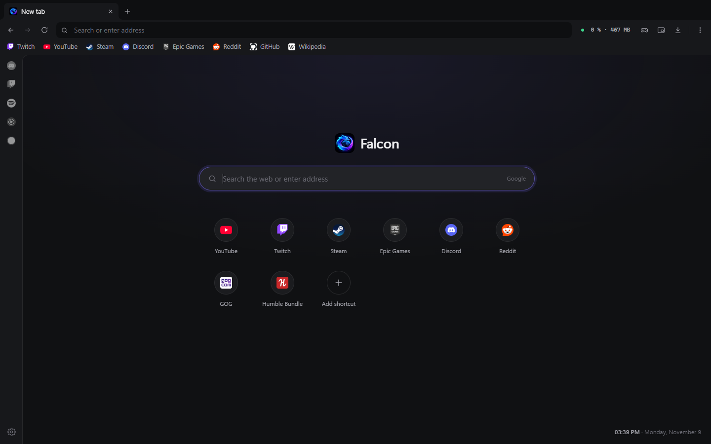
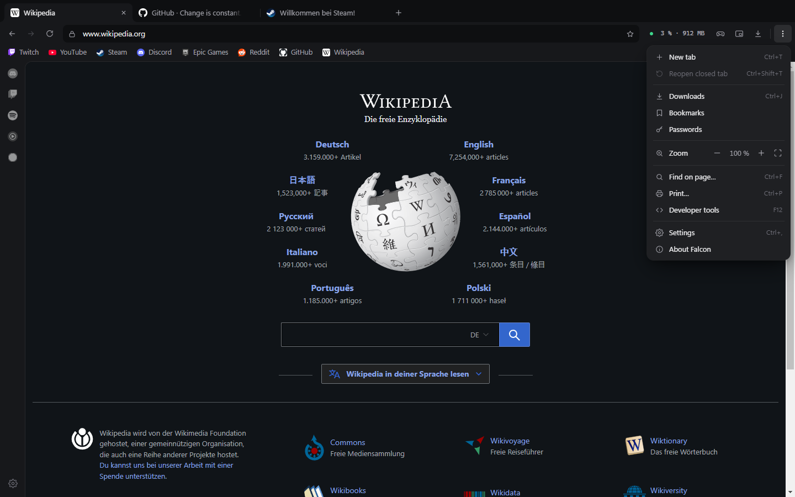
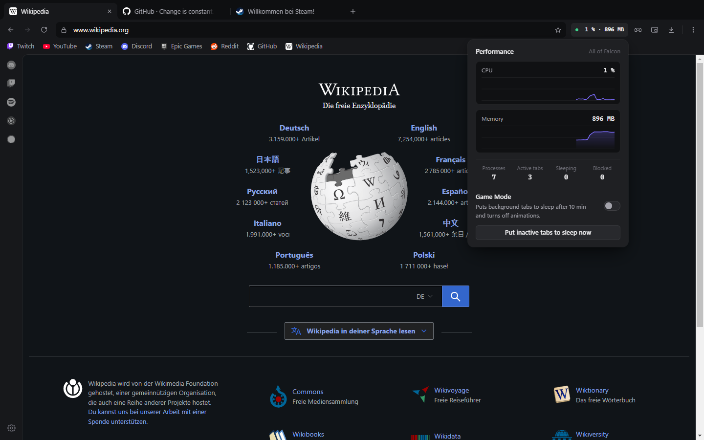
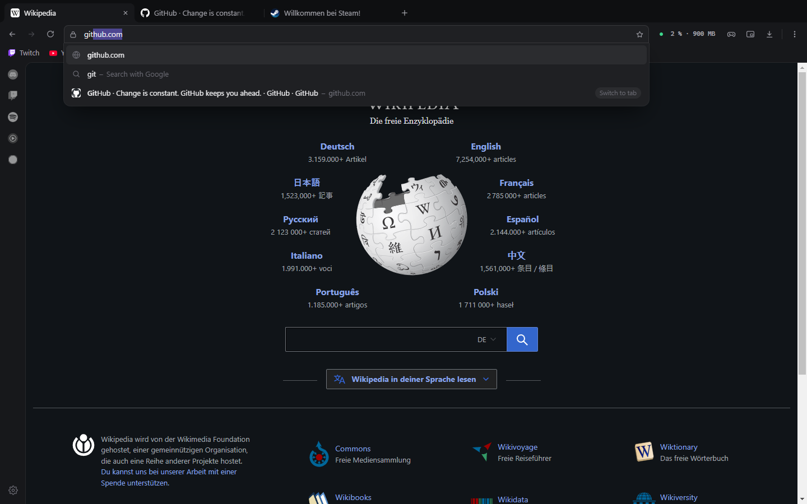
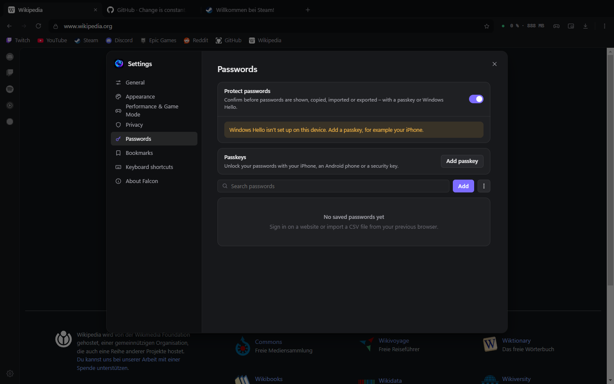

<div align="center">


# Falcon

**A fast, focused Chromium browser built for gamers.**

Game Mode frees up RAM and CPU while you play. Discord, Twitch and Spotify stay one click away in the sidebar.

[](https://github.com/calvinistkrass/Falcon/releases/latest)
[](https://github.com/calvinistkrass/Falcon/releases)
[](#installation)
[](LICENSE)

[**Download**](https://github.com/calvinistkrass/Falcon/releases/latest) · [Features](#features) · [Screenshots](#screenshots) · [Building from source](#building-from-source) · [Changelog](CHANGELOG.md)

<br />



</div>

<br />

## Features

### 🎮 Made for gaming
- **Game Mode**: pauses background tabs after 30 seconds and later puts them to sleep, so your game gets the CPU and memory. Tabs playing audio stay active.
- **Automatic Game Mode** (Windows): turns on while a game runs in full screen and off again afterwards.
- **Tab task manager** in the performance panel: memory and CPU per tab, put tabs to sleep or close them.
- **Saves resources in the background**: tabs are frozen while Falcon is minimized (music, videos, chats and mail stay awake).
- **Network limiter**: caps websites and downloads so your game keeps a stable ping – always or only in Game Mode.
- **Free games & deals** from Steam, Epic and GOG right on the start page.
- **Volume per tab**: turn a stream down without touching Discord.
- **Overlay window**: keep a stream, guide or chat in a small window that stays on top of your game.
- **Performance meter**: live CPU and memory usage in the toolbar, with a 60-second graph.
- **Memory limit**: set a RAM cap and Falcon puts the least recently used tabs to sleep when it's reached.
- **Sidebar apps**: Discord, Twitch, Spotify, YouTube Music, WhatsApp, or any web app you add. They keep running in the background, and the panel is resizable.
- **Picture-in-picture**: pop any video out into a floating window with one click.

### 🧭 A browser that stays out of your way
- **Tabs that behave like Chrome's**: drag to reorder, middle-click to close, duplicate, mute, put to sleep, reopen closed tabs. Your session is restored on startup.
- **Split view**: two tabs side by side with a resizable divider.
- **Chrome extensions** from the Chrome Web Store (Electron supports only part of the extension APIs).
- **Command palette** (Ctrl+K): jump to any open tab, bookmark, history entry, setting or command from the keyboard.
- **Smart address bar**: suggestions from history, bookmarks and open tabs, inline autocomplete and domain highlighting.
- **Bookmark folders** and a searchable **history** (Ctrl+H).
- **Incognito windows** (Ctrl+Shift+N) with a separate in-memory session.
- **Reader view** (F9) for distraction-free articles.
- **Downloads page** (`falcon://downloads`, Ctrl+J) with search, live speed, pause and resume.
- **Default browser** on Windows, macOS and Linux: open links from other apps in Falcon.
- **Screenshot tool** (Ctrl+Shift+S): area, visible part or full page to the clipboard.
- **Translate page** right inside the page.
- **Per-site zoom**, find in page, a download folder of your choice, mouse side buttons, and a custom right-click menu with spell-check suggestions.

### 🛡️ Ad blocker
- **EasyList, EasyPrivacy and more**: over 150,000 filter rules, refreshed weekly, plus hiding of ad slots inside pages and optional removal of cookie banners.
- **Falcon shield** in the address bar shows what was blocked on the current page and turns the blocker off for a single site.

### ☁️ Falcon account & sync
- **Sync between your PCs**: bookmarks, passwords, history and settings – pick what you want to sync.
- **End-to-end encrypted**: data is encrypted on your PC (AES-256-GCM) with a key protected by your password before it's uploaded. The server only ever sees ciphertext.
- **Tabs from other PCs**: open what you were reading on your other computer.
- **Bookmarks on your phone**: the [Falcon web app](https://falconbrowser.de/app) shows your bookmarks and your PCs' tabs, decrypted only on the phone.
- **Profile** with name and color, device names, password reset by email and account deletion.

### 🔐 Passwords & security
- **Password manager**: saves logins encrypted with your Windows account (DPAPI). Passwords are only sent to a page after you pick an account from the list below the login field.
- **Unlock with passkeys**: confirm with your **iPhone, Android phone or a security key** before passwords are shown, copied, imported or exported. Falcon asks with a small prompt first and falls back to Windows Hello.
- **Password checkup**: warns about breached (Have I Been Pwned, k-anonymity), reused and weak passwords.
- **Password generator**: suggests a strong password on sign-up forms and fills it in only when you click it.
- **Import & export** passwords as CSV from Chrome, Edge, Opera, Brave, Firefox or Bitwarden.
- **Passkeys on websites**: sign in with Windows Hello, a security key or your phone – Falcon uses the Windows passkey API directly.
- **Google sign-in works**, unlike in most Electron-based browsers.

### ✨ Everything else
- **5 languages**: English, Deutsch, Français, Español, Türkçe. Falcon follows your system language by default.
- **Bookmarks bar** with folders, an overflow menu and HTML/JSON import and export.
- **Start page** with your own background image.
- **7 accent colors**, native Windows 11 window controls with Snap Layouts.
- **Automatic updates** from GitHub Releases, installed silently in the background.

## Screenshots

<table>
  <tr>
    <td width="50%"><p align="center"><sub>Main menu with zoom controls</sub></p></td>
    <td width="50%"><p align="center"><sub>Performance meter and Game Mode</sub></p></td>
  </tr>
  <tr>
    <td width="50%"><p align="center"><sub>Address bar suggestions</sub></p></td>
    <td width="50%"><p align="center"><sub>Passwords protected by passkeys</sub></p></td>
  </tr>
</table>

## Installation

Download Falcon from [falconbrowser.de](https://falconbrowser.de/download) or the [releases page](https://github.com/calvinistkrass/Falcon/releases/latest):

- **Windows:** run **`Falcon-Setup-x.y.z.exe`**. After that, Falcon keeps itself up to date. Windows SmartScreen may warn you because the app isn't code-signed yet – click **More info → Run anyway**.
- **macOS:** open the `.dmg` for your Mac (Apple chip or Intel) and drag Falcon into Applications. The app isn't signed yet, so open it the first time with right-click → **Open**.
- **Linux:** install the `.deb` (Ubuntu, Debian, Mint …) or the `.rpm` (Fedora, openSUSE …).
- **Android:** install **`Falcon-Mobile-x.y.z.apk`** (allow installing from unknown sources when asked).

### Unlocking passwords with your iPhone or Android phone

1. Open **Settings → Passwords** and click **Add passkey**.
2. In the Windows dialog, choose **iPhone, iPad or Android device** and scan the QR code with your phone's camera.
3. From now on, Falcon asks for your phone before passwords are shown, copied, imported or exported.

Bluetooth must be turned on on your PC; Windows uses it to check that your phone is nearby.

## Building from source

Requires [Node.js](https://nodejs.org) 20 or newer.

```bash
git clone https://github.com/calvinistkrass/Falcon.git
cd Falcon
npm install
npm start          # run in development
npm run dist       # build the installer into dist/
```

### Project structure

| Path | Purpose |
| --- | --- |
| `src/main.js` | Main process: window, settings, downloads, ad blocker, IPC |
| `src/preload.js` | Secure bridge between the main process and the UI |
| `src/ui/` | Browser UI (`index.html`, `styles.css`, modules in `js/`, translations in `locales/`) |
| `src/ui/newtab.html` | Start page |
| `src/passwords.js` | Encrypted password store, CSV import/export |
| `src/passkeys.js`, `src/auth-window/` | Passkey (WebAuthn) registration and verification |
| `src/auth.js` | Windows Hello / Touch ID |
| `src/win-webauthn.js` | Windows passkey API (webauthn.dll) for Falcon and websites |
| `src/webview-preload.js` | Autofill and login detection inside web pages |
| `src/updater.js` | Update checks against GitHub Releases |
| `src/account.js`, `src/firebase-config.js` | Falcon account (Firebase Auth) and end-to-end encrypted sync (Firestore) |
| `src/default-browser.js` | Registers Falcon as a browser in Windows |
| `src/extensions.js` | Chrome extensions (CRX/ZIP unpacking, loading, popups) |
| `src/ui/pages/` | Internal pages such as `falcon://downloads` |
| `docs/app/` | Mobile web app (GitHub Pages) for bookmarks and tabs |
| `src/google-signin.js` | Makes Google sign-in work |
| `src/adblock.js` | Ad blocker (Ghostery engine, per-tab statistics, site exceptions) |
| `src/overlay/` | Always-on-top overlay window |
| `.github/workflows/release.yml` | Builds and publishes a release for every version tag |

### Using your own Firebase project

The account system uses Firebase Authentication (email/password) and Cloud Firestore. To point a fork at your own project, put its web config into `src/firebase-config.js` and set up Firestore security rules so that every user can only access their own data.

### Adding a language

1. Copy `src/ui/locales/en.js` (e.g. to `it.js`) and translate the values.
2. Load it in `src/ui/index.html` and add it to `LANGUAGES` in `src/ui/js/i18n.js`.
3. Add the system dialog strings in `src/i18n-main.js` and the start page strings in `src/ui/newtab.html`.

## Known limitations

- **Netflix, Disney+ and other DRM-protected streaming** don't play, because Electron ships without Widevine.
- **macOS, Linux and Android** don't update themselves yet – download new versions from the website.

## License

[MIT](LICENSE) © Calvin Bandle
